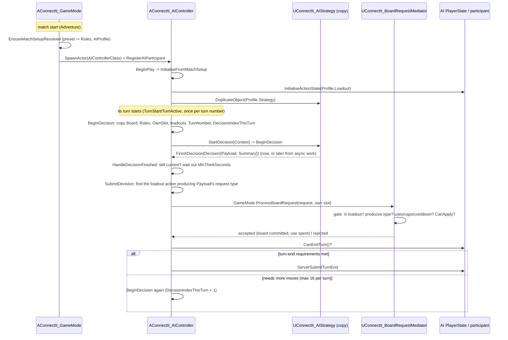

# AI turn: who the opponent is, and how it takes a move

Written against the working tree of 2026-10-14 (the match-preset and Blueprint-strategy-surface changes are in it but not yet
committed, so `commit:` lags). The step-by-step for designers is the recipe
[[set-up-a-custom-ai-opponent]]; this page is the flow behind it.

## What happens

Four things make an AI opponent, and each answers one question. **The GameMode** spawns an `AConnectIt_AIController` (the class
named in its `AIControllerClass`) when an Adventure match starts, and registers it as the second participant. **The match
preset** (via the level config's default, or the main menu's choice) names a **`UConnectIt_AIProfile`**, which says *who* the
opponent is: a **loadout** (what it may do, like a player's) and a **strategy** (how it picks a move). The **controller** never
changes per level: it only owns timing. When its turn starts it copies the board, the match rules and both loadouts into a
decision context, hands that to its own copy of the strategy, waits for the answer, and submits it **through the same Mediator
gate a human uses**, as the loadout action that produces that kind of move. Then it ends the turn, or decides again if the
loadout needs more moves in a turn.

## Diagram

## Steps

1. **Setup (match start).** [[AConnectIt_GameMode]] `HandleMatchHasStarted` resolves the live setup first
   (`EnsureMatchSetupResolved`: the menu's preset, else the level config's `DefaultMatchPreset`; then the menu's own AI-profile
   tweak) and only then, for `MatchType == Adventure`, `SpawnAndRegisterAI`: spawn `AIControllerClass`, register it, and tell the
   rule set which slot is the AI's (`AIFaction`, so the AI's **win groups** apply to it).
2. **Seeding.** The controller's `BeginPlay` (synchronous with the spawn) reads `GameMode->GetAIProfile()`: the profile's loadout
   seeds its PlayerState (`InitialiseActionState`), and its strategy **template is duplicated** into this controller, so decision
   state is per match. No profile = no loadout (every move rejected) and a default MinMax strategy.
3. **Turn start.** The participant component notifies `TurnStart`/`TurnActive`; the controller starts one decision per turn
   number. Pause, game over, turn end, timeout or skip cancel it (a pause resumes it if it is still this AI's turn).
4. **Context.** `BeginDecision` copies, on the game thread: `Board`, `OwnSlot`, `Rules` (plain thread-safe data: scoring and win
   groups, including menu tweaks), `OwnLoadout`/`OpponentLoadout` (assets: game thread only), `TurnNumber`,
   `DecisionIndexThisTurn`.
5. **Decide.** `UConnectIt_AIStrategy::StartDecision` calls the strategy's `BeginDecision` (override it: C++ or Blueprint). The
   strategy answers with `FinishDecision`: now, or later from background work. A late answer after a cancel is ignored.
6. **Think time.** The controller holds the answer until `MinThinkSeconds` have passed since the decision began, so a fast AI
   still reads as thinking.
7. **Submit.** `SubmitDecision` re-checks the decision is current (not superseded, same turn), reads the operation out of
   `Decision.Payload`, finds the loadout action whose class `ProducesRequestType` that operation's request type, and calls
   `GameMode->ProcessBoardRequest` as its own slot.
8. **The gate.** [[UConnectIt_BoardRequestMediator]] holds the AI to the same rules as a human: the action must be in its loadout,
   produce that request type, be usable now (uses, per-turn cap, cooldown), and the operation must `CanApply` to the board. The
   requester's faction is supplied by the server, never by the payload.
9. **End the turn, or go again.** After an accepted move: `PlayerState->CanEndTurn()` true -> `ServerSubmitTurnEnd`. Otherwise
   (the loadout wants more than one move) the controller decides again from the new board, up to 16 times per turn.

## Gotchas

- **A decision with no move stalls the turn.** If `FinishDecision` gets an empty payload (or the strategy never calls it), the
  controller logs a warning and does nothing: the turn then runs to its timer. Always finish with a real operation.
- **A rejected request also stops the AI** (it logs `REJECTED` and does not retry). Usual causes: the loadout has no action
  producing that operation type; the action's uses/caps are spent; the operation can't apply (occupied tile).
- **Strategy state is per controller** (a duplicate of the profile's template), reset each match. Don't expect variables on the
  strategy to survive a new match or to be shared between two AIs.
- **Threads.** `Rules` and `Board` in the context are plain data and safe to hand to a background task; `OwnLoadout`,
  `OpponentLoadout` and the strategy UObject are not. Blueprint strategies run on the game thread.
- **Two factions assumed.** The opponent's loadout is looked up as slot `1 - OwnSlot`.
- **The built-in MinMax only searches Place Piece.** A loadout with swaps or shifts doesn't make MinMax use them; a bespoke
  strategy is how an AI uses those.
- The controller's turn logic is **not overridable from Blueprint** (it is private C++). Customising an AI means the profile
  and the strategy; see the recipe for what a controller subclass is for.
- `CheckAndApplyForcedMove` (a blackboard forced move) is a stub that always returns false.

## Cross-impact

- New board operation the AI should be able to play: the strategy must build it; the AI loadout needs an action that produces it
  ([[add-a-board-request-type]]).
- Changing the decision context (`FConnectItAIDecisionContext`) changes what every Blueprint strategy sees.
- Changing turn-end requirement handling (`ATurnBasedPlayerState::CanEndTurn`) changes how many decisions per turn the AI makes.
- The AI reads the match's win groups through `Rules`; a staged goal is seen as won only when the last group completes
  ([win-condition-stages](../../design/win-condition-stages.md)).

## See also

- Recipe: [[set-up-a-custom-ai-opponent]]
- Design: [blueprint-ai-strategy-surface](../../design/blueprint-ai-strategy-surface.md),
  [ai-profiles-turn-plumbing-and-match-setup](../../design/ai-profiles-turn-plumbing-and-match-setup.md),
  [ai-strategy-and-minmax-rules](../../design/ai-strategy-and-minmax-rules.md),
  [stage-and-match-preset](../../design/stage-and-match-preset.md)
- Decisions: [AI controller runs its own turn](../../_decisions/2026-10-02-ai-controller-runs-its-own-turn.md),
  [AI opponent is a profile asset](../../_decisions/2026-10-02-ai-opponent-is-a-profile-asset.md),
  [pluggable AI strategy](../../_decisions/2026-10-02-pluggable-ai-strategy-and-instance-rules.md)
