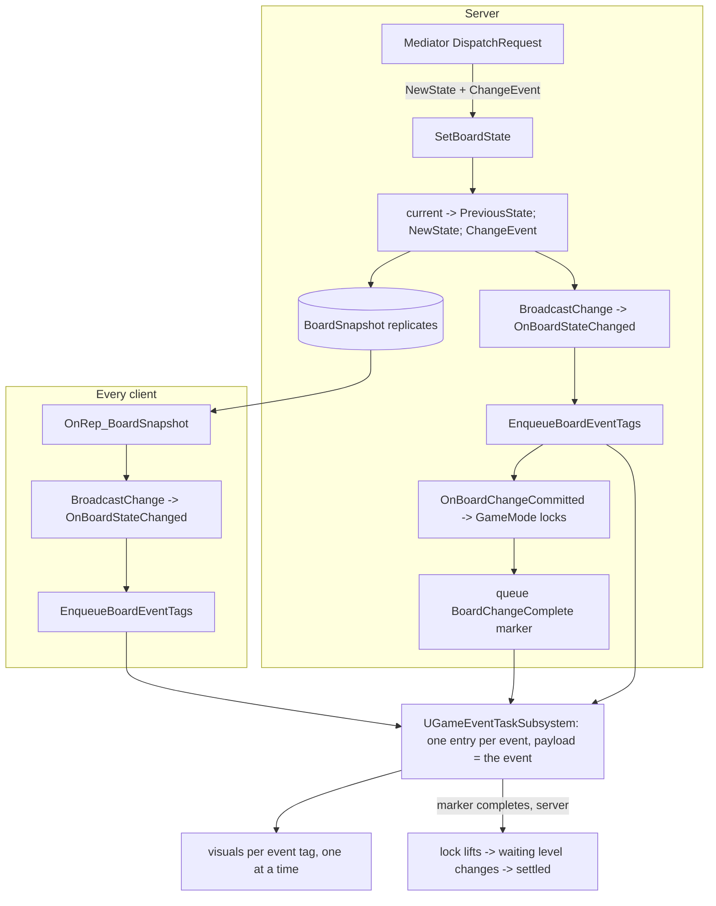

# Board state — single source of truth

## What happens

The entire board is one replicated property: `FConnectItBoardStateSnapshot BoardSnapshot` on
[[UConnectIt_BoardStateComponent]], which lives on the replicated [[AConnectIt_GameState]]. A snapshot is one board
change:

- **Previous state:** the board before the change.
- **Current state:** the board after it, including everything that followed from it (scoring, the win stamp).
- **The change event:** an ordered list of board-event structs saying what happened, in order (`ConnectIt_BoardEvents.h`).

The server writes only through `SetBoardState`; clients receive `OnRep_BoardSnapshot`. Both paths then call
`BroadcastChange()` (the zero-param `OnBoardStateChanged`) and `EnqueueBoardEventTags()`, which queues **one entry per
event, with the event itself as payload**, on the game event queue. The visuals play them one at a time, the same way on
every machine.

**One board change at a time.** The snapshot is a property, not a queue. Unreal sends whatever it holds at the
GameState's next network update, so two changes made between updates would reach a client as one: the first change's
events would never arrive. The server therefore makes no new change until the last has played out:

- After queuing the events, `SetBoardState` fires `OnBoardChangeCommitted` (the GameMode locks) and queues the
  `ConnectIt.Event.BoardChangeComplete` marker.
- When the marker completes, the lock lifts.
- Requests are refused, and level changes wait, until then ([[place-piece-request]]).

## Diagram

## Steps

1. The Mediator builds the new board on a copy (the operation, then the rule set's scoring and win stamp), with the
   ordered `FConnectItBoardChangeEvent`.
2. `SetBoardState(NewState, ChangeEvent)`: current -> `PreviousState`, `NewState` applied, `ChangeEvent` stored in the
   one snapshot.
3. The server broadcasts at once; clients get the snapshot and broadcast from `OnRep_BoardSnapshot`.
4. Both machines: `EnqueueBoardEventTags()` queues each event (its tag, the event as payload). A listener reads the
   event that is playing through `UConnectIt_BoardEventLibrary`, even if a newer snapshot has arrived.
5. Server only: `OnBoardChangeCommitted`, then the completion marker. The GameMode lifts the lock when it completes
   (or after `BoardChangeTimeoutSeconds`), and mirrors "busy" on the GameState (`IsBoardChangeResolving`) for UI.

## Gotchas

- **Never write `CurrentState` directly** -- only `SetBoardState`.
- `OnBoardStateChanged` carries **no parameters** by design: data comes from `GetCurrentState()` / `GetChangeEvent()`.
  That list is the latest change's, not necessarily the one playing.
- `EnqueueBoardEventTags` runs on clients too: anything it triggers must be safe without authority.
- **Gameplay reacts to state, visuals to event tags.** The directors hear `OnBoardStateChanged` when the change is
  committed, before its visuals.
- The marker is server-only and is not a board event (no struct, never in a change list).
- `GameWon` (event) is edge-triggered; `bGameOver` (state) latches.
- `TMap` can't replicate, so `FConnectItBoardState` uses parallel `TilePositions` / `TileDataArray`.

## Cross-impact

Every UI reader (`AConnectIt_GameState` wrappers, `UConnectIt_BoardStateLibrary`, the debug widgets), the MinMax AI
(hypothetical `FConnectItBoardState`s) and the event queue depend on this shape. A new kind of change is a new board
event struct with its tag ([[add-a-board-request-type]]).

## See also

- [[place-piece-request]]
- Decisions: [one board change at a time](../../_decisions/2026-10-21-one-board-change-at-a-time.md),
  [board events are structs carried by the queue](../../_decisions/2026-10-07-board-events-are-structs-carried-by-the-queue.md)
