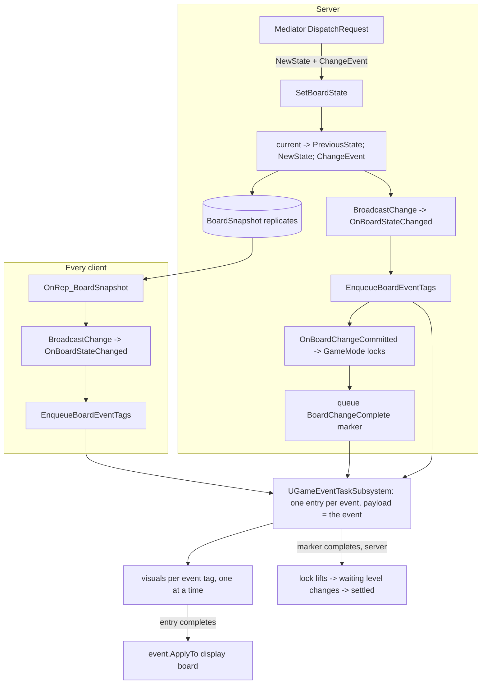

# Board state — single source of truth

## What happens

The entire board is one replicated property: `FConnectItBoardStateSnapshot BoardSnapshot` on
[[UConnectIt_BoardStateComponent]], which lives on the replicated [[AConnectIt_GameState]]. A snapshot is one board
change:

- **Previous state:** the board before the change.
- **Current state:** the board after it, including everything that followed from it (tile powers, scoring, the win
  stamp -- [[tile-power-chain]]).
- **The change event:** an ordered list of board-event structs saying what happened, in order (`ConnectIt_BoardEvents.h`).
  Each event **applies itself** (`FConnectItBoardEvent::ApplyTo`) and names the event that caused it (`CauseIndex`), so
  previous + events = current, chains included (tested).

The server writes only through `SetBoardState`; clients receive `OnRep_BoardSnapshot`. Both paths then call
`BroadcastChange()` (the zero-param `OnBoardStateChanged`) and `EnqueueBoardEventTags()`, which queues **one entry per
event, with the event itself as payload**, on the game event queue. The visuals play them one at a time, the same way on
every machine.

**The display board.** Visuals read `GetDisplayBoard()`, not Current: the board as the player has seen it so far. As
each event's queue entry completes, the event applies itself to it (`OnDisplayBoardChanged`), so a handler playing an
event sees the board before it, plus the event. When the queue drains it copies Current, warning if the tiles or
scores differ (a missed snapshot). Game logic (directors, Mediator, AI) reads Current.

**One board change at a time.** The snapshot is a property, not a queue. Unreal sends whatever it holds at the
GameState's next network update, so two changes made between updates would reach a client as one: the first change's
events would never arrive. The server therefore makes no new change until the last has played out:

- After queuing the events, `SetBoardState` fires `OnBoardChangeCommitted` (the GameMode locks) and queues the
  `ConnectIt.Event.BoardChangeComplete` marker.
- When the marker completes, the lock lifts.
- Requests are refused, and level changes wait, until then ([[place-piece-request]]).

## Diagram

## Steps

1. The Mediator builds the new board on a copy (the operation, then the rule set's power chain and scoring, then the
   win stamp), with the ordered `FConnectItBoardChangeEvent`. (The seed is the same shape: `InitialiseBoardState`
   writes the snapshot directly, Previous = the board as built, Current = it settled once under the rules.)
2. `SetBoardState(NewState, ChangeEvent)`: current -> `PreviousState`, `NewState` applied, `ChangeEvent` stored in the
   one snapshot.
3. The server broadcasts at once; clients get the snapshot and broadcast from `OnRep_BoardSnapshot`.
4. Both machines: `EnqueueBoardEventTags()` queues each event (its tag, the event as payload), each copy stamped with
   its change and index (`PlayChangeId` / `PlayIndex`, local); the change is kept until its events have played, so a
   listener can ask an event's cause (`GetBoardEventCause`). A listener reads the event that is playing through
   `UConnectIt_BoardEventLibrary`, even if a newer snapshot has arrived. The map's **board visualizer** plays every
   event on the actors ([[add-visuals-for-a-board-event]]). When the entry completes, the event applies itself to the
   display board, and the actors whose tiles changed refresh themselves (`RefreshFromBoard`). Once every queued event
   has played, `OnBoardEventsPlayed` fires and the visualizer reconciles every actor against the registries (they own
   where grid actors are: [registries own grid positions](../../_decisions/2026-10-30-registries-own-grid-positions.md)).
5. Server only: `OnBoardChangeCommitted`, then the completion marker. The GameMode lifts the lock when it completes
   (or after `BoardChangeTimeoutSeconds`), and mirrors "busy" on the GameState (`IsBoardChangeResolving`) for UI.

## Gotchas

- **Never write `CurrentState` directly** -- only `SetBoardState`.
- **The set of tiles can change mid-match** (a phased level's Change Layout: Tiles Removed / Tiles Added;
  `FConnectItBoardState::RemoveTileData`). Indices into `TilePositions` / `TileDataArray` are only good for one board --
  look tiles up by position, or by `TileId` (given when a tile joins, travels with it through shifts). The board also
  carries the level's `CurrentPhase`, its `TurnNumber` and `RandomSeed` (tile powers).
- **Visuals read the display board, not Current**: Current is already past the whole chain while its first event is
  still playing.
- **Where an actor is belongs to the registries**, not the board or the actor: a piece's `GetGridPosition` is a cache
  the piece registry writes when it maps it.
- `OnBoardStateChanged` carries **no parameters** by design: data comes from `GetCurrentState()` / `GetChangeEvent()`.
  That list is the latest change's, not necessarily the one playing.
- `EnqueueBoardEventTags` runs on clients too: anything it triggers must be safe without authority.
- **Gameplay reacts to state, visuals to event tags.** The directors hear `OnBoardStateChanged` when the change is
  committed, before its visuals.
- The marker is server-only and is not a board event (no struct, never in a change list).
- `GameWon` (event) is edge-triggered; `bGameOver` (state) latches.
- `TMap` can't replicate, so `FConnectItBoardState` uses parallel `TilePositions` / `TileDataArray`.

## Cross-impact

Every UI reader (`AConnectIt_GameState` wrappers, `UConnectIt_BoardStateLibrary`, the debug widgets), the MinMax AI
(hypothetical `FConnectItBoardState`s) and the event queue depend on this shape. A new kind of change is a new board
event struct with its tag ([[add-a-board-request-type]]).

## See also

- [[place-piece-request]]
- Decisions: [one board change at a time](../../_decisions/2026-10-21-one-board-change-at-a-time.md),
  [board events are structs carried by the queue](../../_decisions/2026-10-07-board-events-are-structs-carried-by-the-queue.md)
