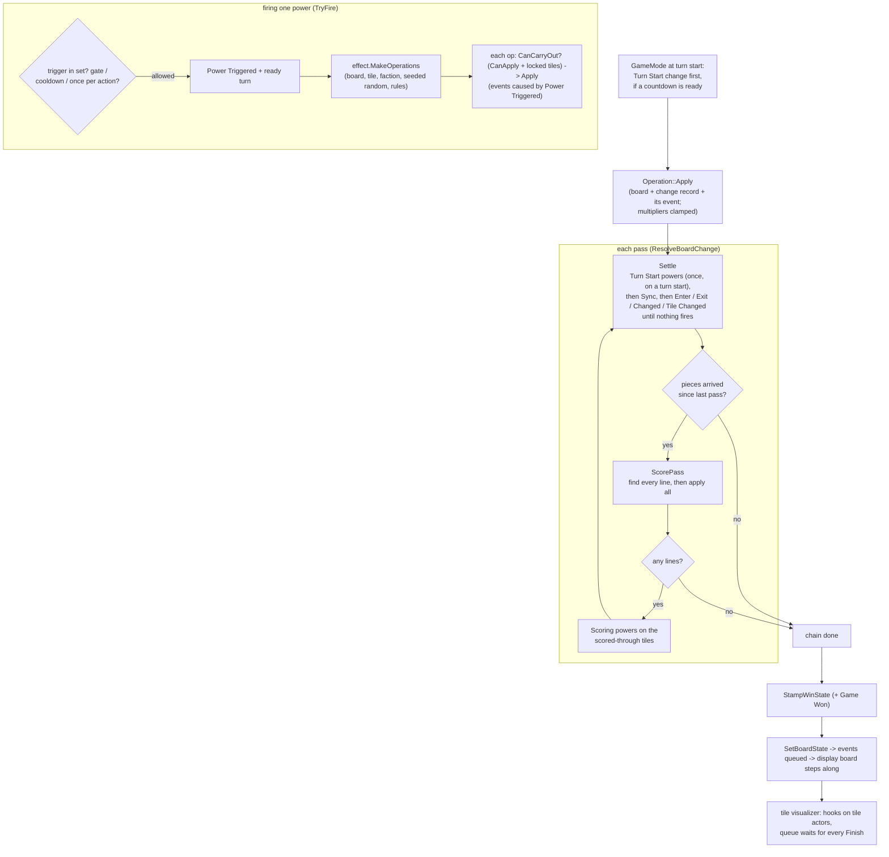

# Tile power chain -- what follows a board change

## What happens

Every board change goes through `FConnectItRuleSet::CarryOutOperation`:

- a player's move;
- a Level director operation;
- a Blueprint **Simulate Operation**;
- a move the AI's search tries;
- the GameMode's **Turn Start** change (below).

1. **The operation changes the board** (`FConnectItBoardOperation::Apply`).
   - It reports what it really did in a change record (`FConnectItBoardChanges`): pieces entered, exited, moved,
     changed owner; tiles changed.
   - Each entry carries the event that caused it (`Cause`).
   - It appends its own event.
   - A multiplier it changes is clamped to the tile type's floor and ceiling (`FConnectItBoardChanges::ClampMultiplier`,
     through the record's `Rules`).
2. **`ResolveBoardChange` resolves what followed**, as one chain. It loops over passes:
   - **Settle** (`FConnectItPowerChain::Settle`):
     - **Turn Start powers**, once, if the record is a turn start (`bTurnStarted`; `RunTurnStartPowers`): every tile
       whose Turn Start power is ready.
     - Sync powers run on every tile they apply to.
     - Then the Piece Enter → Piece Exit → Piece Changed → Tile Changed powers the record sets off, in the record's order.
     - Then again on what those changed, until nothing more fires.
     - Everything they changed is added to the step.
   - **Score** (`FConnectItScoringRule::ScorePass`): every line through every piece that arrived since the last pass is
     found first, then all are applied. One Scored event per line. The record gains the tiles the lines ran through
     (with the scoring faction) and their multiplier changes (+1, clamped to each tile type's limits).
   - **The chain ends at the first pass with no lines.**
   - **Scoring reactions** (`ReactToScoring`): the Scoring powers on those tiles fire. What they and scoring changed goes
     into the next pass's settle.
3. **The win is checked once**, after the chain (`StampWinState`; the Mediator adds Game Won).

**The Turn Start change.** When a turn starts, the GameMode checks `FConnectItRuleSet::HasTurnStartPowerReady`. If a
power is ready, it puts a **Turn Start** operation first in the turn-start level changes
(`FConnectItLevelChangeQueue::AddFirst`), for the faction whose turn it is. The operation changes nothing itself: it
marks the record a turn start, and its settle fires the countdowns (e.g. Repel). It runs before the directors hear the
turn start, one board change at a time. The AI's search doesn't make this change (for now).

**Firing one power** (`FConnectItPowerChain::TryFire`). A power is the tile's own (its tag looked up in the rules'
`TilePowers`, copied from the [tile catalog](../../_decisions/2026-10-22-tile-catalog-and-builder-tiles.md) at match
start) or a level-wide one (`LevelWidePowers`). It fires only for a trigger in its set (`Triggers`, a bitmask).

- **What can stop it:**
  - **the gate:** the effect's `PassesGate` says no (Push, Vacuum, Repel: the tile's multiplier below their
    `Gate.FireAtMultiplier`);
  - **the cooldown:** the board's `TurnNumber` before its ready turn. For a Turn Start power the cooldown is the
    countdown, and its ready turn starts at the turn it joined the board plus the cooldown;
  - **the once-per-action guard:** this tile and power already fired this action -- the tile is its id, so it survives
    shifts. Sync powers skip the cooldown and the guard.
- **When it fires:**
  - It appends **Power Triggered**, whose cause is the event that set it off, and sets its ready turn.
  - The effect picks operations, rolling from the board's `RandomSeed`, which moves on. The shipped effects (Push,
    Vacuum, Repel) list only the Move Pieces the rules allow (`Context.Rules`), then pick one.
  - Each operation is stamped with the faction that set the power off and applied if the rules allow it
    (`FConnectItRuleSet::CanCarryOut`: its own `CanApply`, and no locked tile unless the operation may). Its events name Power
    Triggered as their cause.
  - Nothing applied: `bNoEffect` (it still cools down -- a countdown resets), or, for Sync, no event at all.

**Afterwards, on every machine**, the change's events play one at a time on the game event queue
([[board-state-single-source-of-truth]]). Each applies itself to the **display board** as it finishes playing, so visuals
read the board as far as the player has seen it. The change record stays on the server: clients only get the events.

**Tile hooks.** `UConnectIt_TileVisualizer` has a gated task on each event that concerns tiles (12 tags). When one
plays:

- it finds the tile actors at the event's positions;
- it calls each one's hook (`AConnectIt_TileBase::OnPowerTriggered`, `OnPieceEnter`, ...) with a fresh
  `UConnectIt_TileReaction`;
- the queue moves on only once every reaction has called **Finish**, so a chain plays in order;
- with no actor, or if every hook finished at once, it completes on the next tick.

## Diagram

## Notes

- **No powers, no cost:** with an empty `TilePowers`, settle and the reactions are skipped and nothing extra is copied.
  The AI's search runs the same chain, so a power's cost shows in `ConnectIt.AI.MinMax.Throughput`.
- **Faction:** a power acts for the change that set it off. Enter: the arriving piece's owner. Exit: the leaving piece's
  owner. Changed: the new owner. Tile Changed: the change's faction. Scoring: the scoring faction. Turn Start: whose
  turn it is. Sync: the action's faction.
- **Level-wide powers cool down across the whole board** (`LevelWideReadyTurns`), not per tile.
- **Bug guards:** 64 settle loops, 64 scoring passes; each logs and stops.
- **Before + events = after:** every event's `ApplyTo` reproduces its change, chains included (tested). That is what
  keeps the display board honest. When the queue drains, the display board copies the real board, with a warning if
  they differ.
- **A hook that never calls Finish stalls the queue** -- there is no timeout (owner, by design: no wrapper).
- **Every event the visualizer handles waits at least a frame.** Unnoticeable one event at a time, but a long chain
  plays a frame per event slower.

## Related

- Recipes: [[add-a-tile-power]], [[lock-a-tile-or-chain-tiles]]
- Decisions: [tile powers in the after-move chain](../../_decisions/2026-10-22-tile-powers-in-the-after-move-chain.md),
  [the first tile powers](../../_decisions/2026-10-23-the-first-tile-powers.md)
- Design: [tile-power-triggers](../../design/tile-power-triggers.md); plans: [tile-powers-plan](../../design/tile-powers-plan.md),
  [first-tile-powers-plan](../../design/first-tile-powers-plan.md)
- Flows: [[place-piece-request]], [[board-state-single-source-of-truth]], [[ai-turn]]
