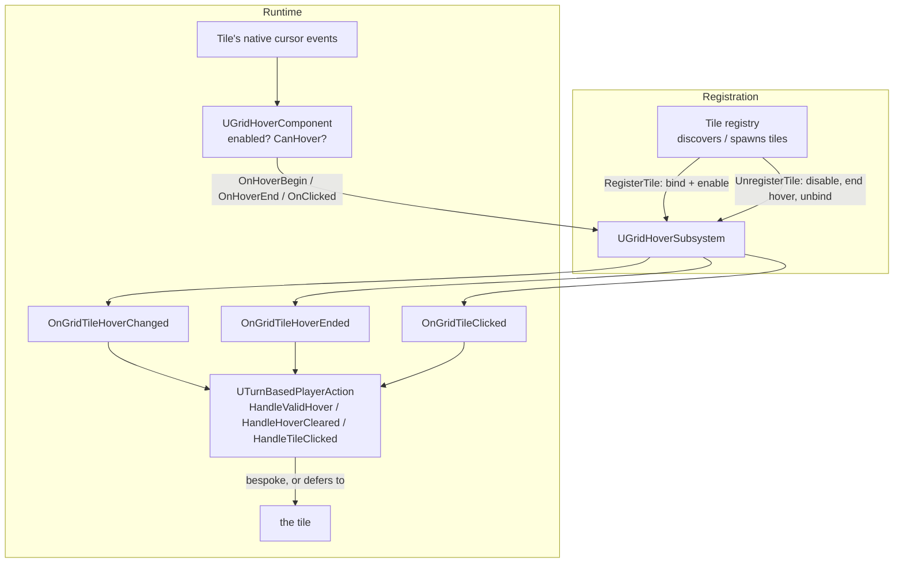

# Hover relay

## What happens

Each tile's [[UnrealGridMechanics/code/UGridHoverComponent|UGridHoverComponent]] turns the tile's cursor events into
hover begin / end / click **in C++**. `UGridHoverSubsystem` binds the components of **registered** tiles only, and
chains them into three relays: `OnGridTileHoverChanged` (begin), `OnGridTileHoverEnded` and `OnGridTileClicked`.
Registration is driven by the tile registry, never by the actors, so only board tiles report. The listeners (the
player actions) decide what a hover or click means; tiles don't react to hover on their own. **Only tiles are hovered:**
pieces ignore the cursor trace, and the piece on a tile is found through the hovered tile.

## Diagram

## Steps

1. **Register:** the tile registry calls `UGridHoverSubsystem::RegisterTile`. That binds the tile's `HoverComponent`
   (`BindTile`) and enables it. `UnregisterTile` first disables the component (a hover on it ends, and the end is still
   relayed), then unbinds it.
2. **Hover:** the tile's Begin / End Cursor Over and Clicked reach the component (bound in its `BeginPlay`), which
   broadcasts them if it is enabled and `CanHover` allows. The subsystem relays them with the tile.
3. **Consume:** an active `UTurnBasedPlayerAction` with selection binds the three relays:
   - **begin** → `HandleHoverCleared` on the previous tile, then `HandleValidHover` if `IsValidHoverTile`, else
     `HandleInvalidHover` (2026-10-30);
   - **end** (for the tile it holds as hovered) → `HandleHoverCleared`;
   - **click** → `HandleTileClicked`, which does nothing by default because the selection input already selects
     (`HandleValidSelection`).

## Gotchas

- **Only registered tiles relay.** A tile that isn't hovered: is it registered? Does a primitive block the cursor trace
  channel (map check warns, naming the channel -- and says so if the owner blocks only Visibility)?
- **One channel, one setting:** `UGridMechanicsSettings::CursorTraceChannel` (Project Settings > Plugins > Grid
  Mechanics); the plugin defines **GridCursor** (slot 18) in its own `Config/Engine.ini`. Tiles block it on their
  root primitive and pieces ignore it, set in C++ at `OnConstruction`; the ConnectIt player controller traces it.
  See [grid cursor trace channel](../../../ConnectIt/_decisions/2026-10-30-grid-cursor-trace-channel.md).
- **A piece over a tile:** pieces also set every primitive to ignore the cursor channel in `PostInitializeComponents`
  (`AGridPieceBase::bBlocksCursorTrace`, default false). A Blueprint that sets a collision profile later undoes that.
- The subsystem doesn't hit-test or decide. It forwards what the components raise.
- **Deprecated, kept for one release:**
  - `AGridTileBase::OnGridTileBeginCursorOver`, forwarded from the component;
  - the piece relay (`RegisterPiece`, `OnGridPieceHoverChanged`, `AGridPieceBase::OnGridPieceBeginCursorOver`).
  Neither reaches the tile relays.
- Registration state lives in `TSet`s; `Deinitialize` unbinds whatever is left.

## Cross-impact

Changing the relay signatures touches `UTurnBasedPlayerAction` (`BindGridSubsystem`), the cursor manager
(`AGridCursorManagerBase`, unused here) and any UI bound to hover. Changing the component's delegates touches
`UGridHoverSubsystem::BindTile` and `AGridTileBase`.

## See also

- [[UnrealGridMechanics/code/UGridHoverComponent|UGridHoverComponent]],
  [[UnrealGridMechanics/code/UGridTileRegistryComponent|UGridTileRegistryComponent]]
- Decision: [[ConnectIt/_decisions/2026-10-28-hover-through-a-component|hover through a component]]
- Tests: `UnrealGridMechanics.Hover.Component`, `UnrealGridMechanics.Hover.Subsystem`
